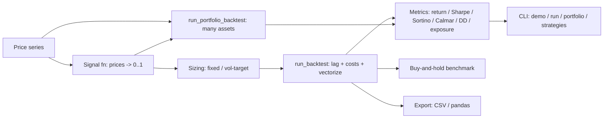

<p align="center">
  
</p>

<h1 align="center">Backtesting Python</h1>

<p align="center">
  <strong>A small, fast, vectorized backtesting engine for trading strategies — in pure Python + NumPy.</strong><br>
  Write a signal, size it, run it across one asset or a whole portfolio, and compare against buy-and-hold in milliseconds.
</p>

<p align="center">
  <em>Built and maintained by <a href="https://viprasol.com">Viprasol Tech</a> — Fintech Experts. Full-Stack Builders.</em>
</p>

<p align="center">
  <a href="https://github.com/Viprasol-Tech/backtesting-python/actions/workflows/ci.yml"></a>
  <a href="LICENSE"></a>
  
  
  
  
  <a href="https://t.me/viprasol_help"></a>
  <a href="https://github.com/Viprasol-Tech/backtesting-python/stargazers"></a>
</p>

---

> ## ⚠️ Disclaimer
> This software is for **educational purposes only** and is **not financial advice**. Trading involves substantial risk, including the **total loss of capital**. Backtest results are **not** indicative of future performance and can be distorted by overfitting, survivorship bias, and unrealistic fills. Always validate independently and comply with your local laws. **Use at your own risk** — Viprasol Tech assumes no responsibility for your trading results.

---

## ✨ Features

- ⚡ **Vectorized engine** — NumPy under the hood; backtest hundreds of bars instantly.
- 🧭 **No look-ahead bias** — positions are lagged one bar, so today's signal trades tomorrow.
- 📊 **Buy-and-hold benchmark** — every run reports your strategy *and* the passive baseline.
- 🧮 **Rich metrics** — total return, CAGR, Sharpe, **Sortino**, **Calmar**, annual volatility, max drawdown, and **exposure**.
- 🪙 **Position sizing** — `fixed_fraction` and an inverse-volatility `volatility_target` sizer with leverage caps.
- 🧰 **Bundled strategies** — momentum, RSI mean-reversion, Bollinger and Donchian breakouts, buy-and-hold.
- 🧺 **Portfolio backtests** — run one signal across many assets and blend into a single weighted equity curve.
- 💸 **Transaction costs** — charge proportional costs on turnover and see the drag.
- 📤 **CSV / pandas export** — dump equity curves and summary metrics for plotting or reporting.
- 🖥️ **Rich CLI** — `demo`, `run`, `portfolio`, and `strategies` subcommands.
- ⚙️ **Modern tooling** — ruff, mypy (strict), pytest, GitHub Actions CI.

## 🚀 Quickstart

```bash
git clone https://github.com/Viprasol-Tech/backtesting-python.git
cd backtesting-python
python -m pip install -e ".[dev]"

# Backtest a moving-average crossover on synthetic data:
backtesting-python demo
backtesting-python demo --fast 5 --slow 40

# Backtest a bundled strategy with vol-targeting + costs, export to CSV:
backtesting-python run momentum --sizing vol-target --cost 0.0005 --csv equity.csv

# Blend a strategy across several assets:
backtesting-python portfolio donchian --assets 3

# List bundled strategies:
backtesting-python strategies
```

## 🧩 Run your own backtest

```python
from backtesting_python import run_backtest, moving_average_crossover

prices = [100, 101, 99, 103, 105, 104, 108, 110, 107, 112]

result = run_backtest(
    prices,
    lambda p: moving_average_crossover(p, fast=2, slow=4),
    starting_equity=10_000.0,
    cost_per_turnover=0.0005,  # 5 bps per unit of turnover
)

print(f"Total return:  {result.strategy_total_return:.2%}  (B&H {result.buy_hold_total_return:.2%})")
print(f"CAGR:          {result.cagr:.2%}")
print(f"Sharpe:        {result.sharpe_ratio:.2f}   Sortino: {result.sortino_ratio:.2f}")
print(f"Calmar:        {result.calmar_ratio:.2f}   Max DD:  {result.max_drawdown:.2%}")
print(f"Exposure:      {result.exposure:.1%}      Costs:   ${result.total_costs:.2f}")
```

### Size a strategy and export the equity curve

```python
from backtesting_python import (
    run_backtest, momentum, volatility_target, write_equity_csv,
)

prices = [100 + i * 0.5 for i in range(300)]

# Scale exposure to a 15% annualised vol target.
sized = lambda p: volatility_target(p, momentum(p, lookback=20), target_vol=0.15)
result = run_backtest(prices, sized)

write_equity_csv(result, "equity.csv")  # strategy vs buy-and-hold, per bar
```

### Backtest a multi-asset portfolio

```python
from backtesting_python import run_portfolio_backtest, donchian_breakout

price_data = {
    "BTC": [...],
    "ETH": [...],
    "SOL": [...],
}

port = run_portfolio_backtest(
    price_data,
    donchian_breakout,
    weights=[0.5, 0.3, 0.2],   # normalised automatically; equal-weight by default
)

print(f"Portfolio CAGR: {port.cagr:.2%}  Sharpe: {port.sharpe_ratio:.2f}")
print(port.per_asset_total_return)
```

## 🏗️ Architecture



## 📚 API / feature reference

| Component | What it does |
| --- | --- |
| `run_backtest(prices, signal_fn, …)` | Single-asset long/flat backtest with costs and lagged positions. |
| `run_portfolio_backtest(price_data, signal_fn, weights=…)` | Multi-asset weighted portfolio backtest. |
| `moving_average_crossover` | Canonical fast/slow SMA crossover signal. |
| `momentum`, `rsi_reversion`, `bollinger_breakout`, `donchian_breakout`, `buy_and_hold` | Bundled example strategies (also in `STRATEGIES`). |
| `fixed_fraction`, `volatility_target` | Position-sizing helpers turning signals into weights. |
| `total_return`, `cagr`, `sharpe_ratio`, `sortino_ratio`, `calmar_ratio` | Return / risk-adjusted metrics. |
| `annualized_volatility`, `max_drawdown`, `exposure`, `equity_curve` | Risk and curve metrics. |
| `result_to_frame`, `write_equity_csv`, `summary_dict`, `write_summary_csv` | Export helpers (pandas / CSV). |

## 🗺️ Roadmap

- [x] Vectorized long/flat engine with buy-and-hold benchmark
- [x] Pure metric functions (return, Sharpe, max drawdown) + MA-crossover signal
- [x] Extended metrics (Sortino, Calmar, CAGR, volatility, exposure)
- [x] Position sizing (fixed fraction, volatility targeting)
- [x] Bundled strategies (momentum, RSI, Bollinger, Donchian)
- [x] Transaction-cost model on turnover
- [x] Portfolio (multi-asset) backtests
- [x] CSV / pandas export and CLI subcommands
- [ ] Long/short positions and configurable leverage
- [ ] Pandas / CSV data loaders and equity-curve plotting
- [ ] Walk-forward and parameter-sweep tooling

## ❓ FAQ

**Does the engine look ahead?** No. Positions are shifted one bar, so a signal computed at the close of bar *t* is acted on at bar *t + 1*.

**What position values are allowed?** Any weight in `[0, 1]` — `{0, 1}` is the common long/flat case, and sizers produce fractional weights in between.

**How are costs modelled?** As a proportional charge on turnover: `cost = cost_per_turnover * |Δposition|` at each bar.

**Can I use my own data?** Yes — pass any list/array of prices (or a dict of symbol → prices for portfolios). No specific data source is assumed.

**Is it production trading software?** No. It is a research/education tool — read the disclaimer above.

## 🤝 Contributing

PRs welcome — see [CONTRIBUTING.md](CONTRIBUTING.md) and our [Code of Conduct](CODE_OF_CONDUCT.md).

## Contact — Viprasol Tech Private Limited

- Website: [viprasol.com](https://viprasol.com)
- Email: [support@viprasol.com](mailto:support@viprasol.com)
- Telegram: [t.me/viprasol_help](https://t.me/viprasol_help) | WhatsApp: +91 96336 52112
- GitHub: [@Viprasol-Tech](https://github.com/Viprasol-Tech) | [LinkedIn](https://www.linkedin.com/in/viprasol/) | X [@viprasol](https://twitter.com/viprasol)

## License

[MIT](LICENSE) (c) 2025 Viprasol Tech Private Limited
