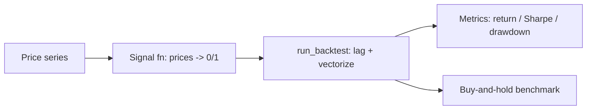

<p align="center">
  
</p>

<h1 align="center">Backtesting Python</h1>

<p align="center">
  <strong>A small, fast, vectorized backtesting engine for trading strategies — in pure Python + NumPy.</strong><br>
  Write a signal function, run a backtest, and compare your strategy against buy-and-hold in milliseconds.
</p>

<p align="center">
  <em>Built and maintained by <a href="https://viprasol.com">Viprasol Tech</a> — Fintech Experts. Full-Stack Builders.</em>
</p>

<p align="center">
  <a href="https://github.com/Viprasol-Tech/backtesting-python/actions/workflows/ci.yml"></a>
  <a href="LICENSE"></a>
  
  <a href="https://t.me/viprasol_help"></a>
  <a href="https://github.com/Viprasol-Tech/backtesting-python/stargazers"></a>
</p>

---

> ## ⚠️ Disclaimer
> This software is for **educational purposes only** and is **not financial advice**. Trading involves substantial risk, including the **total loss of capital**. Backtest results are **not** indicative of future performance and can be distorted by overfitting, survivorship bias, and unrealistic fills. Always validate independently and comply with your local laws. **Use at your own risk** — Viprasol Tech assumes no responsibility for your trading results.

---

## ✨ Features

- ⚡ **Vectorized engine** — NumPy under the hood; backtest hundreds of bars instantly.
- 🧭 **No look-ahead bias** — positions are lagged one bar, so today's signal trades tomorrow.
- 📊 **Buy-and-hold benchmark** — every run reports your strategy *and* the passive baseline.
- 🧮 **Pure metric functions** — `total_return`, `sharpe_ratio`, `max_drawdown` are side-effect-free and trivial to test.
- 🧩 **Bring your own signal** — any `prices -> list[{0, 1}]` function plugs straight in.
- 🖥️ **CLI** — `backtesting-python demo` runs a moving-average crossover on synthetic data.
- ⚙️ **Modern tooling** — ruff, mypy (strict), pytest, GitHub Actions CI.

## 🚀 Quickstart

```bash
git clone https://github.com/Viprasol-Tech/backtesting-python.git
cd backtesting-python
python -m pip install -e ".[dev]"

# Backtest a moving-average crossover on synthetic data:
backtesting-python demo
backtesting-python demo --fast 5 --slow 40
```

## 🧩 Run your own backtest

```python
from backtesting_python import run_backtest, moving_average_crossover

prices = [100, 101, 99, 103, 105, 104, 108, 110, 107, 112]

result = run_backtest(
    prices,
    lambda p: moving_average_crossover(p, fast=2, slow=4),
    starting_equity=10_000.0,
)

print(f"Strategy total return: {result.strategy_total_return:.2%}")
print(f"Buy & hold total return: {result.buy_hold_total_return:.2%}")
print(f"Sharpe: {result.sharpe_ratio:.2f}  Max drawdown: {result.max_drawdown:.2%}")

# Or write a custom signal — any prices -> list of 0/1 positions:
def buy_the_dip(prices):
    avg = sum(prices) / len(prices)
    return [1 if px < avg else 0 for px in prices]

result = run_backtest(prices, buy_the_dip)
```

## 🏗️ Architecture



## 🗺️ Roadmap

- [x] Vectorized long/flat engine with buy-and-hold benchmark
- [x] Pure metric functions (return, Sharpe, max drawdown) + MA-crossover signal
- [ ] Transaction costs and slippage models
- [ ] Long/short and fractional position sizing
- [ ] Pandas / CSV data loaders and equity-curve plotting

## 🤝 Contributing

PRs welcome — see [CONTRIBUTING.md](CONTRIBUTING.md) and our [Code of Conduct](CODE_OF_CONDUCT.md).

## Contact — Viprasol Tech Private Limited

- Website: [viprasol.com](https://viprasol.com)
- Email: [support@viprasol.com](mailto:support@viprasol.com)
- Telegram: [t.me/viprasol_help](https://t.me/viprasol_help) | WhatsApp: +91 96336 52112
- GitHub: [@Viprasol-Tech](https://github.com/Viprasol-Tech) | [LinkedIn](https://www.linkedin.com/in/viprasol/) | X [@viprasol](https://twitter.com/viprasol)

## License

[MIT](LICENSE) (c) 2025 Viprasol Tech Private Limited
